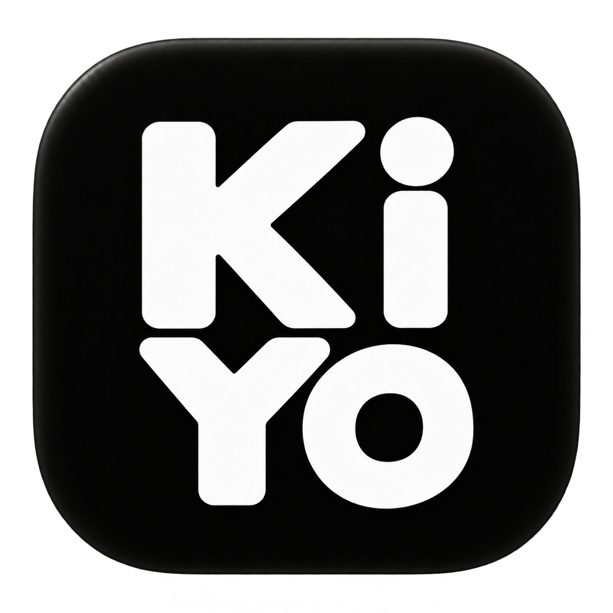
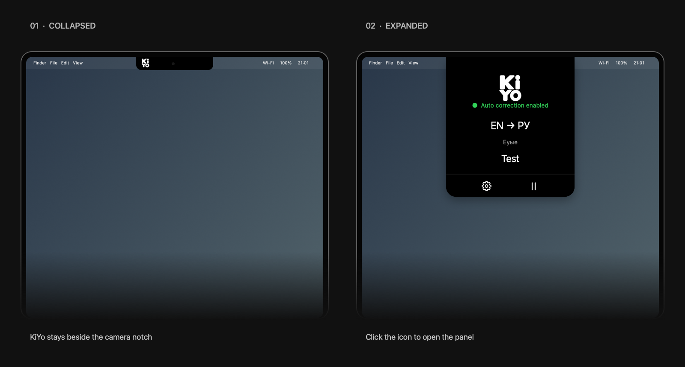
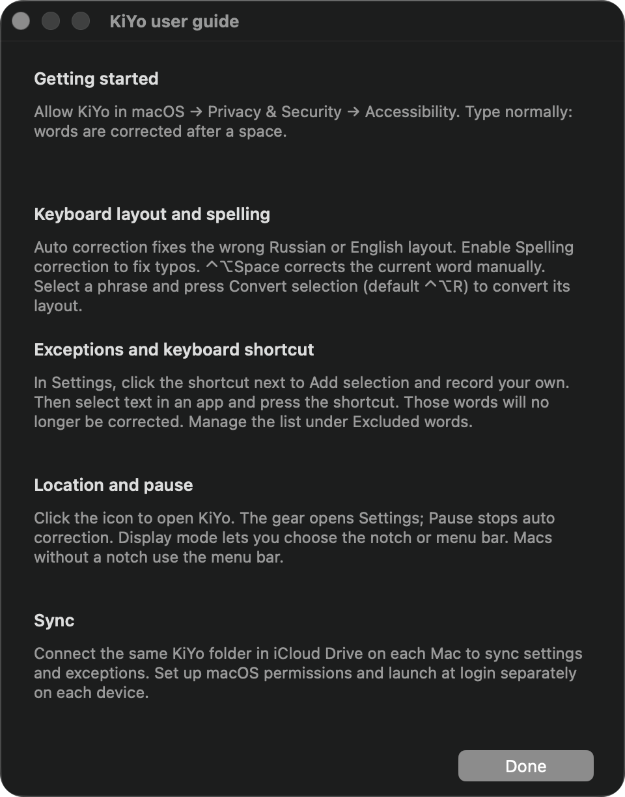
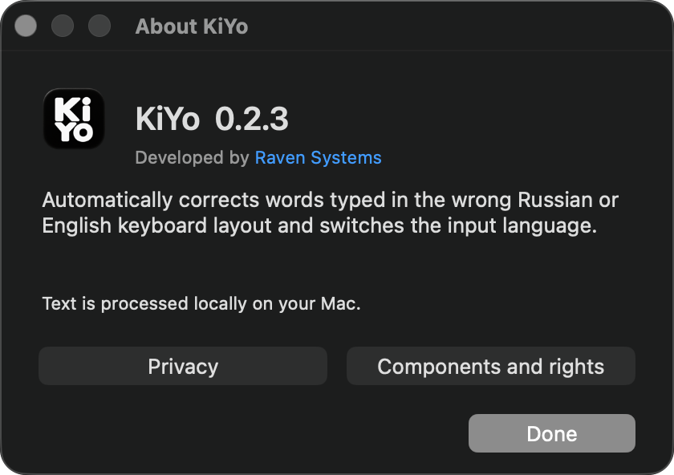

<p align="center">
  
</p>

# KiYo

KiYo is a macOS utility by [Raven Systems](https://ravensystems.io/) that corrects words typed in the wrong Russian or English keyboard layout and switches the input language.


<h2 align="center">Download KiYo for Mac</h2>
<p align="center">
  <a href="https://github.com/RavenSystemsDev/KiYo/releases/download/v0.2.3-rc1/KiYo-0.2.3-rc1.dmg"></a>
</p>
<p align="center"><b>0.2.3-rc1</b> · Apple Silicon · macOS 13+</p>

> **Install in three steps**
> 1. Click **Download KiYo** above and open the `.dmg` file.
> 2. Drag **Kiyo.app** into **Applications**.
> 3. Open KiYo from Applications and enable access in **System Settings → Privacy & Security → Accessibility**.
>
> You do not need to download or build the source code.

[Direct DMG download](https://github.com/RavenSystemsDev/KiYo/releases/download/v0.2.3-rc1/KiYo-0.2.3-rc1.dmg) · [Release notes and SHA-256](https://github.com/RavenSystemsDev/KiYo/releases/tag/v0.2.3-rc1)

**Preview build:** not notarized by Apple; macOS may block launch. Do not disable Gatekeeper.

[GitHub repository](https://github.com/RavenSystemsDev/KiYo) · [Русский](README.ru.md) · [License](LICENSE) · [Security](SECURITY.md) · [Privacy](Resources/en.lproj/Privacy.txt)

**Source-available, not OSI open source.** Companies may use KiYo internally. Selling KiYo, paid derivative versions or paid access is not permitted under this license. Redistributed applications must show creator attribution and the Raven Systems link. See [LICENSE](LICENSE) for the actual terms.

## Features

- Automatic RU/EN layout correction after a space, preserving Tab and Return actions.
- Optional macOS spelling suggestions, conservative joined-word splitting using the system dictionary and canonical KiYo capitalization.
- Word exceptions, configurable shortcuts for adding exceptions and converting selected text, and a macOS text Service where supported.
- Notch or menu-bar display, pause, manual correction and opt-in launch at login.
- Russian/English interface, welcome screen and a separate user guide.
- Optional preferences and exceptions sync through a user-selected folder, including iCloud Drive.
- Bug reports and feature requests from Settings open an email to dev@ravensystems.io; sending remains under your control.

## See KiYo in action

<p align="center">
  
</p>

Notch mode: the compact icon and expanded panel. MacBook placement illustration using an actual KiYo screenshot.

<details>
<summary>User guide and About KiYo</summary>

<p align="center">
  
</p>
<p align="center">
  
</p>

</details>

## Requirements and build

Apple Silicon Mac, macOS 13+, Apple command-line developer tools with Swift, and Python 3 for the publication audit. Runtime behavior has been tested on macOS 26.6.2; older supported deployment versions need testing.

```sh
./build.sh
./scripts/test.sh
python3 scripts/audit-public.py
```

Build output is `dist/Kiyo.app`. The default build is ad-hoc signed for local development; it is not a notarized public release. It creates no signing keychain and does not modify certificate trust. Do not replace an installed signed release with a development build: macOS may require Accessibility permission again.

To use an existing signing identity available in your own keychain:

```sh
KIYO_SIGNING_IDENTITY='Developer ID Application: YOUR IDENTITY' ./build.sh
```

No signing certificate, private key or password is included. Public binaries require the maintainer's Developer ID signing and Apple notarization. Do not disable Gatekeeper.

To package the built application:

```sh
./scripts/package-dmg.sh
```

The package contains the app, an Applications link and a short installation guide. Generated builds are ignored by Git.

## Use

Allow KiYo in System Settings → Privacy & Security → Accessibility. Enable Russian and English input sources. Layout correction runs after a word boundary. Control + Option + Space manually converts the current buffered word. Single-letter words are deliberately not changed automatically. If a correction is immediately erased completely with Backspace, its original word is preserved only on the next retry within 15 seconds, without changing persistent exceptions.

Spelling is a separate, optional setting. It uses system dictionaries and can miss names, technical identifiers and ambiguous errors. It does not guarantee correct prose in every editor.

To exclude selected text, press the shortcut shown in Settings → Add selection (default Control + Option + K). Click that button to record your own shortcut. Escape cancels. Convert selection (default Control + Option + R) changes the layout of selected text, including multiple lines; its shortcut is configurable separately. Secure Input and recognized password/email fields are skipped; custom editors can expose incomplete metadata.

## Privacy and sync

Typed words are processed locally. There is no developer telemetry or keystroke log. Settings and explicit exceptions are persistent; do not put passwords in exceptions. The last correction and a limited spelling cache can remain in memory.

Sync is opt-in: select the same folder on each Mac. iCloud Drive transfers files if you choose an iCloud Drive folder. Permissions and launch-at-login stay device-specific. Copy fallback for selection uses the clipboard temporarily and attempts to restore its prior formats. See the bundled privacy text for details and limitations.

Optional `--diagnostics` writes text-free counters to `~/Library/Caches/local.kiyo.switchet/health.json`. Ordinary launches do not write diagnostics.

## Tests and releases

Tests use simulated events that never enter the operating system and isolated sync preferences/folders. Physical typing, real login and real two-Mac sync require separate acceptance checks. No GitHub CI result is claimed before running it on GitHub.

Current source: 0.2.2 release candidate. Developer ID/notarization and the publication checks in [Docs/PUBLICATION.txt](Docs/PUBLICATION.txt) remain separate from a successful local build. Current architecture uses cross-application Accessibility and is not prepared for Mac App Store App Sandbox.

## Contributions and security

Read [CONTRIBUTING.md](CONTRIBUTING.md). For vulnerabilities, follow [SECURITY.md](SECURITY.md); never post real passwords, clipboard contents or private certificates in an issue.
